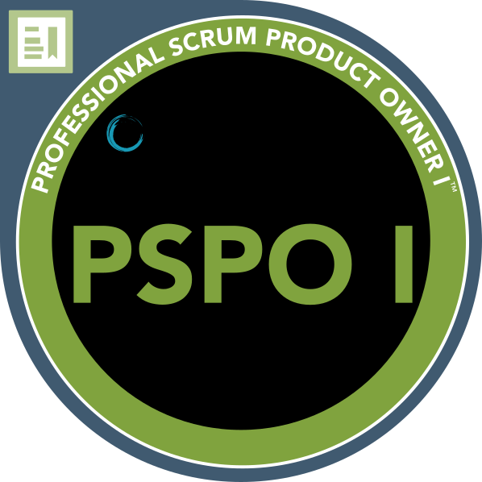

## About {#about}

I engineer web and mobile systems that ==are built to last==.

Fifteen years of experience developing and maintaining enterprise-grade applications have me well prepared for the next phase of AI-driven software development. Hands-on lead with sound technical judgment, continuous mentoring, constructive code reviews, and structured onboarding.

## Experience {#experience}

### Senior Software Engineer + Satellytes
2021 – today + Munich, Fulda

Lead engineer and core contributor for ZEISS, ADAC Motorsport, FC Bayern München and MediaMarktSaturn.

- **ZEISS AURA® Smart Analyzer** + companion app for a new ZEISS near-infrared spectrometer
- **MyZEISS** + projects for MyZEISS Vision and Meditec
- **MediaMarktSaturn** + pilot projects in the webmobile team
- **ADAC Motorsport** + migration from Gatsby Cloud / Netlify to a new custom built engine using GitHub Actions and DigitalOcean
- **FC Bayern München** + relaunch of fcbayern.com

### Freelance Senior Web Developer
2018 – 2021 + Munich

Working with Satellytes and for jambit as external Senior Software Architect, I developed full stack web applications and core frameworks, to support the development of new applications for customers like Audi and FC Bayern. The toolchain included Angular, Spring WebFlux, CI/CD with Jenkins and Cloud Foundry.

### (Senior) Product Engineer + SinnerSchrader, now Accenture Song
2013 – 2018 + Munich

Frontend engineer and lead for BMW Group eRetail and Allianz MyInvest, a living styleguide for Audi and a pattern library for Allianz. Senior from 2016.

### Software Engineer + TomTec Imaging Systems
2013 + Unterschleißheim

Development of clinical reporting features in Java and JavaScript, a Selenium test framework in Ruby, development of a C++ conversion tool for DICOM medical image datasets.

## Education {#education}

### Diplom-Informatiker + University of Koblenz-Landau
2005 – 2013 + Computervisualistik

Computer graphics, interface design and semantic web research. Young Talent Award 2011.

- [strukt: A Pattern System for Integrating Individual and Organizational Knowledge Work](site/docs/paper__scherp_eissing_staab--strukt-a_pattern_system.pdf) + ISWC 2011
- [Analysis and Comparison of Models for Individual and Organisational Knowledge Work](site/docs/paper__scherp_eissing_staab--analysis_and_comparison.pdf) + MKWI 2012
- [A Method for Integrating Multimedia Metadata Standards and Metadata Formats with the Multimedia Metadata Ontology](site/docs/paper__scherp_eissing_saathoff--a_method_for_integrating_multimedia_metadata.pdf) + IJSC 2012

## Skills {#skills}

### Frontend
`TypeScript` `React` `Next.js` `Gatsby` `Angular` `TanStack Query` `XState` `Storybook` `Playwright` `d3.js`

### Mobile
`Expo` `React Native` `Expo Router` `Skia` `Bluetooth LE` `SQLite` `Over-the-air updates`

### Backend and cloud
`Node.js` `GraphQL` `Apollo` `NestJS` `.NET` `HotChocolate` `PostgreSQL` `Azure` `AWS Lambda` `Docker`

### Architecture and delivery
`Monorepos` `Module Federation` `Design systems` `GitHub Actions` `Azure Pipelines` `Terraform` `Vitest` `Jest`

### Ways of working
`Tech lead` `Mentoring` `Code reviews` `Scrum` `Remote teams` `AI coding agents`

### Spoken languages
`German (native speaker)` `English (full professional proficiency)` `French (limited working proficiency)`

### Certifications

[Professional Scrum Product Owner™ I (PSPO I)](https://www.credly.com/badges/9f36896a-7623-46d5-a36e-3800703bcdef) + Scrum.org