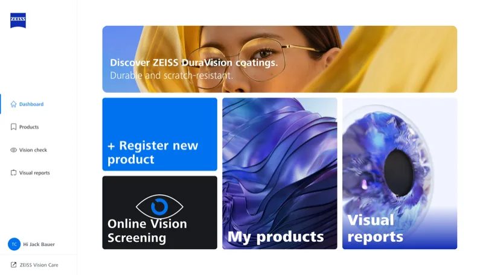
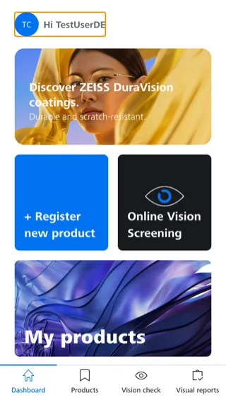
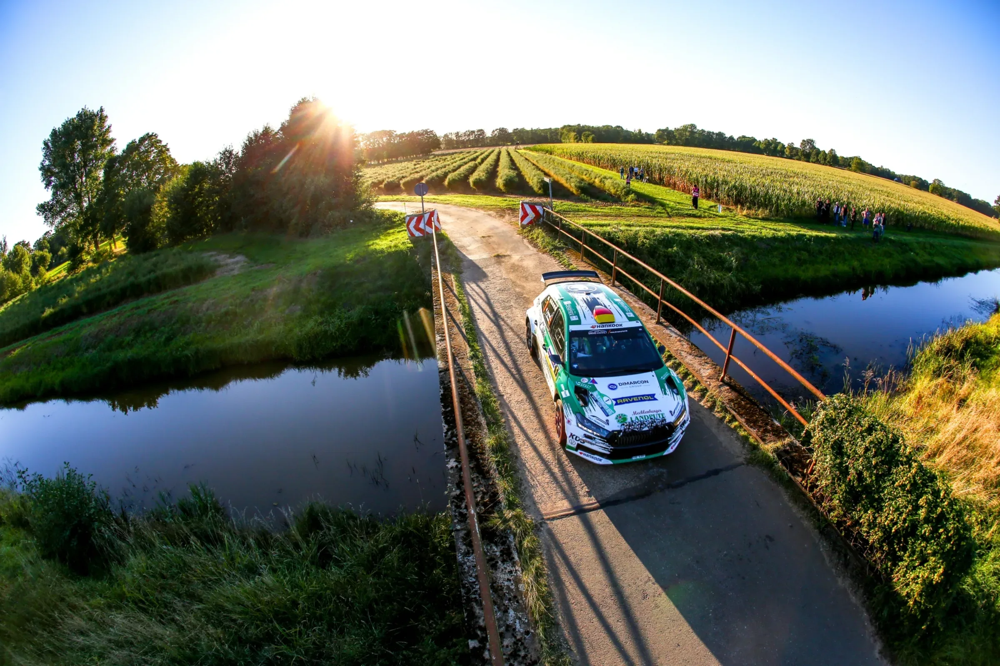
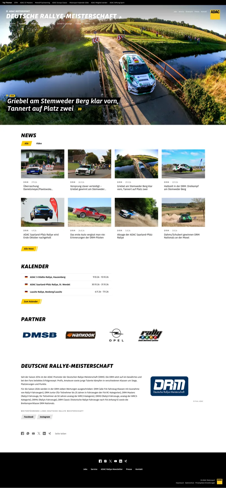
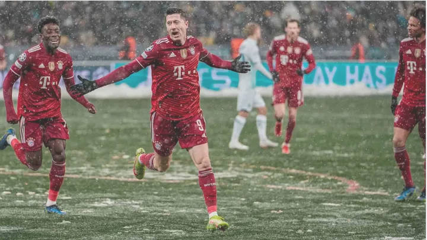
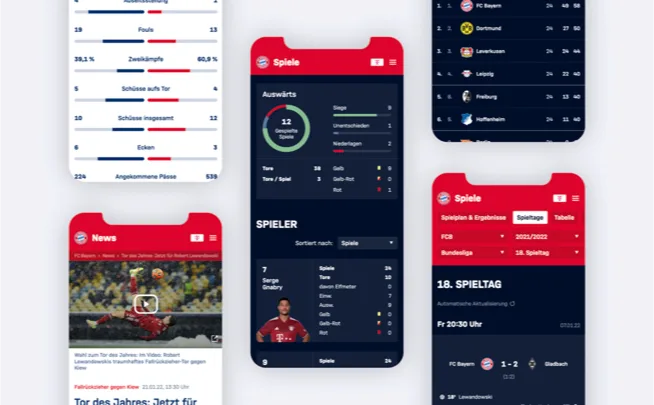
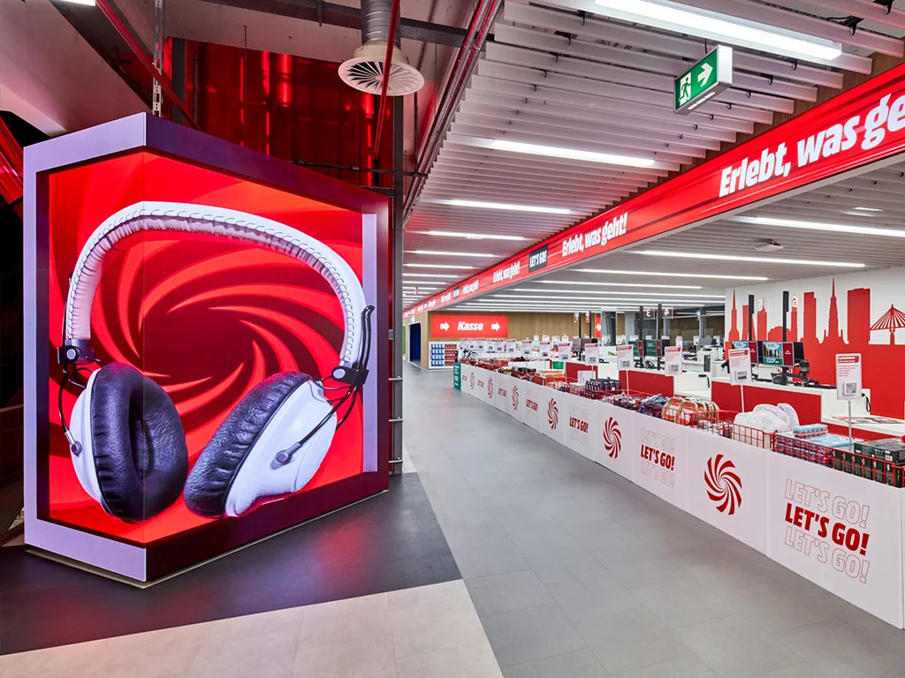
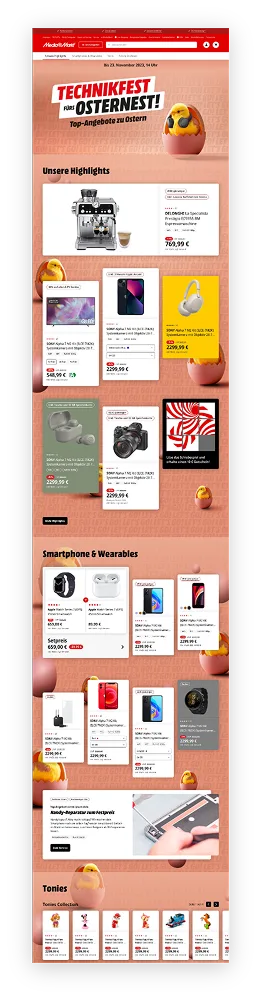

<!--
Die deutsche Seite, veröffentlicht unter /portfolio/. Ihr englischer Zwilling ist portfolio.md.
Wie diese Datei geschrieben wird: README.md, "Writing portfolio.md".
-->

## Über mich {#about}

Ich baue große Web- und Mobile-Apps, die ==über Jahre live bleiben==.

Dreizehn Jahre Frontend-Architektur, Designsysteme und Monorepos, erst bei SinnerSchrader, dann als Freiberufler und bei Satellytes. Seit 2023 zunehmend Full-Stack: GraphQL- und Node.js-Services, Azure und seit 2025 eine React-Native-App mit der .NET-Plattform dahinter. Ich leite seit 2014 Frontend-Teams und bin so gern Mentor, wie ich ausliefere.

- **13 Jahre** in der Softwareentwicklung
- **4 Lead-Rollen** seit 2019
- **Web + Mobile** React · Expo · .NET
- **Fulda** remote seit 2021

### Architektur, die hält
Monorepos, Micro-Frontends und Designsysteme für Produkte, die jahrelang laufen, von FC Bayern bis ZEISS.

### Führen durch Bauen
Lead Developer, der weiter viel Code selbst schreibt, mit Releases, Reviews, Onboarding und Mentoring.

### Vom Interface bis in die Cloud
Angefangen habe ich mit Interface-Design und Computergrafik. Heute baue ich auch die APIs, Pipelines und Cloud-Infrastruktur hinter dem Interface.

## Marken {#brands}

Produkte für Marken, ==die Sie kennen==.

Daran habe ich in Teams von SinnerSchrader, heute Accenture Song, und Satellytes gearbeitet, an den meisten mehrere Jahre lang. Ich weiß also, wie große Unternehmen Software bauen: mit Designsystemen, Barrierefreiheit, Release-Prozessen und vielen Beteiligten rund um ein Produkt.

## Projekte {#projects}

### AURA Smart Analyzer {#aura}
2025 – heute · ZEISS Spectroscopy · Lead Developer

1. **AURA NIR**: misst die Probe
2. **Expo-App**: Bluetooth-Verbindung, Vorhersagen auf dem Smartphone, komplett offline
3. **Cloud-Plattform**: Kalibrierungen, Anmeldung und Over-the-Air-Updates

Begleit-App für das tragbare Nahinfrarot-Spektrometer von ZEISS, fast vollständig von mir geschrieben. Sie verbindet sich per Bluetooth LE, rechnet ONNX-Kalibriermodelle ohne Netz direkt auf dem Smartphone und aktualisiert die Firmware des Geräts over the air. Dazu habe ich den Update-Service auf Azure Functions, einen Hardware-in-the-Loop-Prüfstand und ein TypeScript-SDK mit Protocol Buffers gebaut und an der .NET-Plattform mitgearbeitet. 70 Releases seit Januar 2026.

`Expo` `React Native` `TypeScript` `XState` `Skia` `ONNX` `.NET` `GraphQL` `Azure`

### MyZEISS {#myzeiss}
2023 – 2025 · ZEISS Vision Care · ZEISS Meditec · Lead Developer

<!-- Daniel: die nächsten zwei Absätze bitte in eigenen Worten neu schreiben. Sie behaupten nur, was die Commits zeigen. -->
In MyZEISS Vision registrieren Menschen, die ZEISS-Gläser tragen, ihre Produkte, machen einen Online-Sehtest und lesen ihre Sehberichte. Ich habe die Web-App Ende-zu-Ende verantwortet: 16 der 17 Produktiv-Releases seit November 2024, die neu gestalteten Produkt-, Rezept- und Garantieseiten und die App-Shell des Redesigns, das heute live ist.

Für ZEISS Meditec habe ich die Device Training API von Brandmaker auf Veeva Vault umgezogen und den Service gebaut, der Kunden über ihre Geräte benachrichtigt.

`React` `TypeScript` `Vite` `Azure Functions` `TanStack Query` `Turborepo` `GraphQL`

### ADAC Motorsport {#adac}
2021 – 2025 · adac-motorsport.de · Lead Developer

Das Zuhause der ADAC-Rennserien, von der DTM bis zur Deutschen Rallye-Meisterschaft: Gatsby und React auf Contentful, mit Serverless-Tools auf AWS für Content-Migrationen. Als Gatsby Cloud eingestellt wurde und Netlify 2.700–5.700 $ im Monat anbot, habe ich die Builds auf GitHub Actions umgezogen, mit Build-Servern auf DigitalOcean, die ein Workflow selbst aufsetzt: 140 $ im Monat, 10 % schneller und 40 % günstiger als zuvor, ohne Ausfall.

`Gatsby` `React` `TypeScript` `Contentful` `GraphQL` `GitHub Actions` `AWS Lambda`

### FC Bayern München {#fcbayern}
2019 – 2022 · fcbayern.com · Lead Developer

Relaunch von fcbayern.com auf einem Headless CMS mit einem Satellytes-Team von sechs Leuten. Ich habe im Juli 2019 den ersten Prototyp des Frontend-Monorepos aufgesetzt und fast drei Jahre darauf aufgebaut. Die Website umfasst rund 100.000 statisch generierte Seiten mit inkrementellen Updates, Liveticker und Echtzeit-Ergebnisse, helles und dunkles Theme, WCAG 2.0 und über 2.000 Unit-Tests. Im August 2021 habe ich in drei Tagen den Großteil des Online-Kondolenzbuchs für Gerd Müller gebaut.

`Gatsby` `React` `TypeScript` `GraphQL` `Apollo` `Lerna` `Storybook` `Jest`

### MediaMarktSaturn {#mediamarktsaturn}
2022 – 2023 · webmobile-Team · Developer

Das webmobile-Team baut die Services und Apps rund um den Onlineshop von MediaMarkt. Ich habe Jotform-Formulare an Kampagnen- und Redaktionsseiten angebunden, für das Produkttester-Programm „Testpiloten“ die Formulare und den Einsendungs-Service als Contentful-App und NestJS-API gebaut und der Kampagnenplattform eine Tracking-Bibliothek hinzugefügt.

`Next.js` `React` `NestJS` `Contentful` `Nx` `GraphQL`

## Erfahrung {#experience}

### Senior Software Engineer · Satellytes
2021 – heute · München, remote aus Fulda

Lead Developer für ZEISS, ADAC Motorsport und FC Bayern München, Developer für MediaMarktSaturn.

### Freiberuflicher Senior Web Developer
2018 – 2021 · München

Für Satellytes ab 2019 und für jambit als externer Senior Software Architect bei einem süddeutschen Automobilhersteller: Angular-Framework und -Libraries, Spring-WebFlux-Backends, CI/CD mit Jenkins und Cloud Foundry.

### (Senior) Product Engineer · SinnerSchrader
2013 – 2018 · München, heute Accenture Song

Frontend-Lead für BMW eRetail und Allianz MyInvest, ein Living Styleguide für Audi und eine Pattern Library für die Allianz. Senior ab 2016.

### Software Engineer · TomTec Imaging Systems
2013 · Unterschleißheim

Reporting-Features in Java und JavaScript, ein Selenium-Testframework in Ruby, Tests für ein C++-Konvertierungstool.

### Diplom-Informatiker · Universität Koblenz-Landau
2005 – 2013 · Computervisualistik

Computergrafik, Interface-Design und Forschung zum Semantic Web. Young Talent Award 2011.

- [strukt: A Pattern System for Integrating Individual and Organizational Knowledge Work](site/docs/paper__scherp_eissing_staab--strukt-a_pattern_system.pdf) · ISWC 2011
- [Analysis and Comparison of Models for Individual and Organisational Knowledge Work](site/docs/paper__scherp_eissing_staab--analysis_and_comparison.pdf) · MKWI 2012
- [A Method for Integrating Multimedia Metadata Standards and Metadata Formats with the Multimedia Metadata Ontology](site/docs/paper__scherp_eissing_saathoff--a_method_for_integrating_multimedia_metadata.pdf) · IJSC 2012

## Skills {#skills}

### Frontend
`TypeScript` `React` `Next.js` `Gatsby` `Angular` `TanStack Query` `XState` `Storybook` `Playwright` `d3.js`

### Mobile
`Expo` `React Native` `Expo Router` `Skia` `Bluetooth LE` `SQLite` `Over-the-Air-Updates`

### Backend und Cloud
`Node.js` `GraphQL` `Apollo` `NestJS` `.NET` `HotChocolate` `PostgreSQL` `Azure` `AWS Lambda` `Docker`

### Architektur und Delivery
`Monorepos` `Module Federation` `Designsysteme` `GitHub Actions` `Azure Pipelines` `Terraform` `Vitest` `Jest`

### Arbeitsweise
`Tech-Lead` `Mentoring` `Code-Reviews` `Scrum` `Remote-Teams` `KI-Coding-Agenten`

## Kontakt {#contact}

Sie suchen einen Senior Engineer, der vorangeht und selbst baut? ==Sprechen wir.==

Ich bin offen für Senior- und Lead-Rollen in der Web-, Mobile- und Full-Stack-Entwicklung.

### Datenschutz
Diese Seite setzt keine Cookies und verfolgt niemanden. Die Schriften liegen auf dieser Website. GitHub Pages hostet sie und kann IP-Adressen protokollieren, siehe [Datenschutzerklärung von GitHub](https://docs.github.com/en/site-policy/privacy-policies/github-general-privacy-statement).

### Logos
Die Logos sind Marken ihrer Inhaber. Sie nennen Unternehmen, für die ich gearbeitet habe, direkt oder über eine Agentur, und bedeuten keine Empfehlung.
